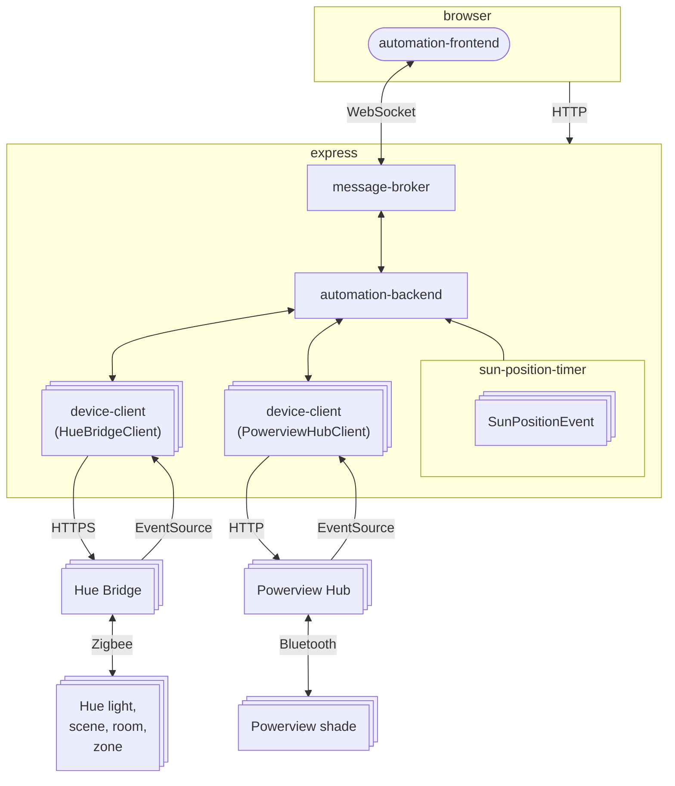
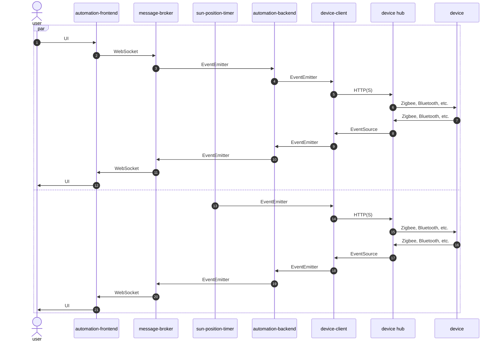

Copyright (c) 2026 Kirk Rader

# Home Automation Server

Monitor and control a [Hue] and [PowerView] based home automation system using
[express] and [Vue]

- [automation-backend]
  - An [express] project containing the back end of a home automation server
- [automation-frontend]
  - A [Vue] project containg the front end of a home automation server

## Architecture



---



## Install, Configure, Build

See the individual `README.md` files for [automation-backend] and
[automation-frontend].

## Launch

### Production

If you have configured [automation-backend] to run as a `systemd` [daemon], you
can use the [redeploy.sh] script to stop the service, pull the latest sources,
rebuild the frontend, and restart the service simply by running:

```sh
./redeploy.sh
```

in the directory containing this `README.md` file.

### Manual

Browse to the URL displayed in the console window after invoking:

```bash
cd automation-backend
node index.js
```

By default, the back end [express] app serves whatever HTML is at
`../automation-frontend/dist/` relative to its launch directory. I.e.
`node index.js` in the back end directory serves the output of `npm run build`
in the front end directory in addition to handling on-going interactions with
"smart" home devices. [Note that the location from which to serve the frontend
SPA can be overridden by adding the absolute path to the static root directory
as the value of the `root` property in `automation-backend/config.js`, though
given the current architecture of [automation-backend], this is of questionable
utility.]

Once `index.js` is running, you can then open a browser to the URL implied by
the values for `config.frontendPort` in `./automation-backend/config.js` and
`VITE_SERVER_WS` in `./automation-frontend/.env.local`, e.g.
`http://myserver.local:8080`.

_**Note that adding support for TLS encryption and some form of authentication
would be required to make it safe to expose this server to the internet for
access outside of the home.**_

### Dev / Test

For development in an IDE and testing in non-production instances, you can run
the front and back ends independently by altering the settings in the
configuration files to refer to `localhost` rather than the host name or IP
address of your production server. You can then use the normal [Vue] work flow
to connect either to the production back end or a locally running back end
instance on your development machine. E.g. you can launch a local instance of
the back end by invoking `node index.js` in the `./automation-backend` directory
in one shell and then changing the `VITE_SERVER_WS` URL in `.env.local` to refer
to `localhost`:

```
VITE_SERVER_WS=ws://localhost:8081
VITE_LATITUDE=34.052238
VITE_LONGITUDE=-118.243340
VITE_ELEVATION=0
```

Running `npm run dev` in the `./automation-frontend` directory in another shell
will then launch the [Vue] SPA, connecting to the local back end instance.

[automation-backend]: ./automation-backend/README.md
[automation-frontend]: ./automation-frontend/README.md
[daemon]: ./automation-backend/README.md#linux-systemd
[express]: https://expressjs.com/
[Hue]: https://developers.meethue.com/develop/hue-api-v2/getting-started/
[PowerView]: https://www.hunterdouglas.com/operating-systems/motorized/powerview
[redeploy.sh]: ./redeploy.sh
[Vue]: https://vuejs.org/
