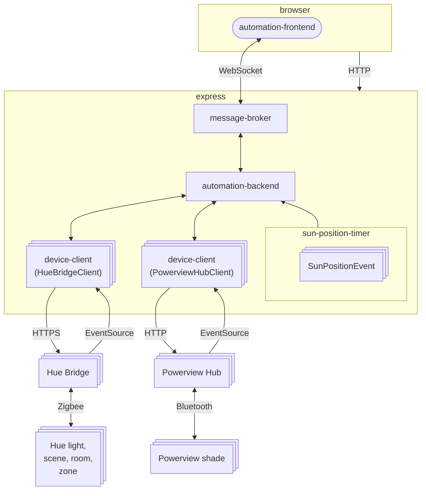
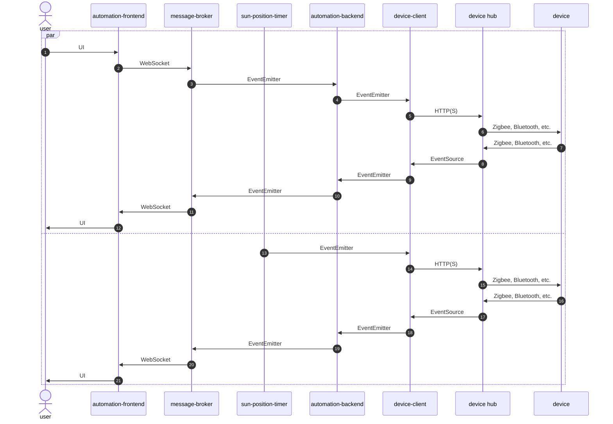

Copyright (c) 2026 Kirk Rader

# Home Automation Server

Monitor and control a [Hue] and [PowerView] based home automation system using
[express] and [vuetify]

- [automation-backend]
  - An [express] project containing the back end of a home automation server
- [automation-frontend]
  - A [Vue] project containg the front end of a home automation server

## Architecture



---



## Installation

```bash
cd automation-backend
npm i
cd ../automation-frontend
npm i
```

## Configuration

### Back End

Create `./automation-backend/config.js` with appropriate values for your
location and hardware:

```javascript
const config = {

    logger: {
        name: 'automation',
        maxBackups: 3,
        maxSize: 1047552,
    },

    frontendPort: 8080,
    wssPort: 8081,

    location: {
        latitude: 34.052238,
        longitude: -118.243340,
        elevation: 0,
    },

    hue: [
        {
            bridgeId: 'd53896fffec424ab',
            apiKey: '28a4QSK429JDHOyHidv5Ef1Tx-i-b4hYruFHVKIO',
        },
        {
            bridgeId: 'fab5faccbe212f0d',
            apiKey: '2P6zDhsdGdzmEXNMLmV21ypt404AVdxZY2ofksrH',
        },
    ],

    powerview: [
        {
            id: 'bff46430-9989-11f1-8be1-e31a95383439',
            address: '192.168.1.51',
            name: 'Living / Dining Room',
            type: 'legacy',
        },
        {
            id: '348cd80-9989-11f1-a63b-1f68433e5c42',
            address: '192.168.1.32',
            name: 'Kitchen',
            type: 'gen3',
        },
    ],
}

export default config
```

See <https://developers.meethue.com/develop/hue-api-v2/getting-started/> for an
explanation of the `hue.bridgeId` and `hue.apiKey` values (the latter being the
value to use for the `hue-application-key` parameter when sending HTTPS requests
to the bridge API.)

### Font End

Create `./automation-frontend/.env.local`:

```
VITE_SERVER_WS=ws://myserver.local:8081
VITE_LATITUDE=34.052238
VITE_LONGITUDE=-118.243340
VITE_ELEVATION=0
```

The values in `./automation-frontend/.env.local` must be consistent with the
corresponding entries in `./automation-backend/config.js`.

- The hostname for `VITE_SERVER_WS` must be the DNS name or IP address of the
  machine running the back end.
- The port number for `VITE_SERVER_WS` must be the same as the value for
  `config.wssPort` in the back end configuration file.
- The geolocation attributes are duplicated in the front end configuration file
solely to support certain testing scenarios.

## Build

```bash
cd automation-frontend
npm run build
```

There is no build step for the back end.

## Launch

### Production

Browse to the URL displayed in the console window after invoking:

```bash
cd automation-backend
node index.js
```

The back end [express] app serves whatever HTML is at
`../automation-frontend/dist` relative to its launch directory. I.e.
`node index.js` in the back end directory serves the output of `npm run build`
in the front end directory in addition to handling on-going interactions with
"smart" home devices.

You can then open a browser to the URL implied by the values for
`config.frontendPort` in `./automation-backend/config.js` and `VITE_SERVER_WS`
in `./automation-frontend/.env.local`, e.g. `http://myserver.local:8080`.

_**Note that adding support for TLS encryption and some form of authentication
would be required to make it safe to expose this server to the internet for
access outside of the home.**_

### Dev / Test

For development in an IDE and testing in non-production instances, you can run
the front and back ends independently by altering the settings in the
configuration files to refer to `localhost` rather than the host name or IP
address of your production server. You can then use the normal [Vue] work flow
to connect either to the production back end or a locally running back end
instance on your development machine. E.g. you can launch a local instance of
the back end by invoking `node index.js` in the `./automation-backend` directory
in one shell and then changing the `VITE_SERVER_WS` URL in `.env.local` to refer
to `localhost`:

```
VITE_SERVER_WS=ws://localhost:8081
VITE_LATITUDE=34.052238
VITE_LONGITUDE=-118.243340
VITE_ELEVATION=0
```

Running `npm run dev` in the `./automation-frontend` directory in another shell
will then launch the [Vue] SPA, connecting to the local back end instance.

[automation-backend]: ./automation-backend/README.md
[automation-frontend]: ./automation-frontend/README.md
[express]: https://expressjs.com/
[Hue]: https://developers.meethue.com/develop/hue-api-v2/getting-started/
[PowerView]: https://www.hunterdouglas.com/operating-systems/motorized/powerview
[Vue]: https://vuejs.org/