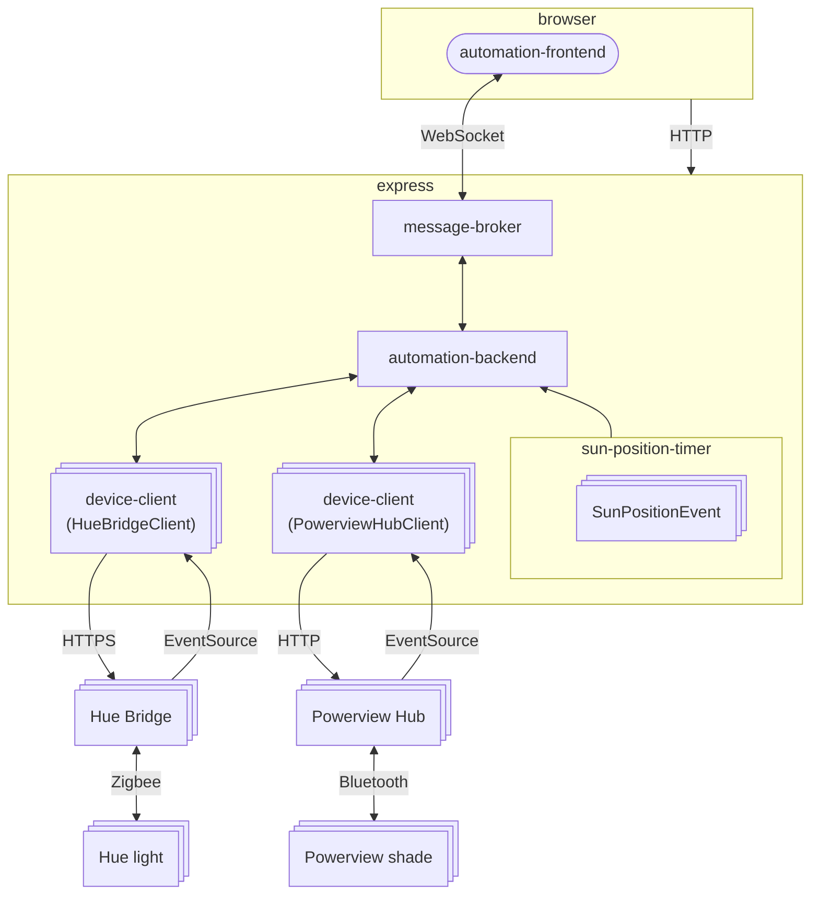
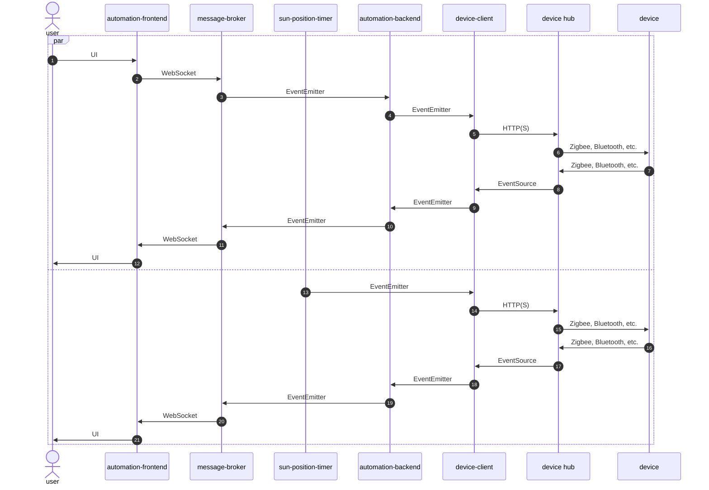
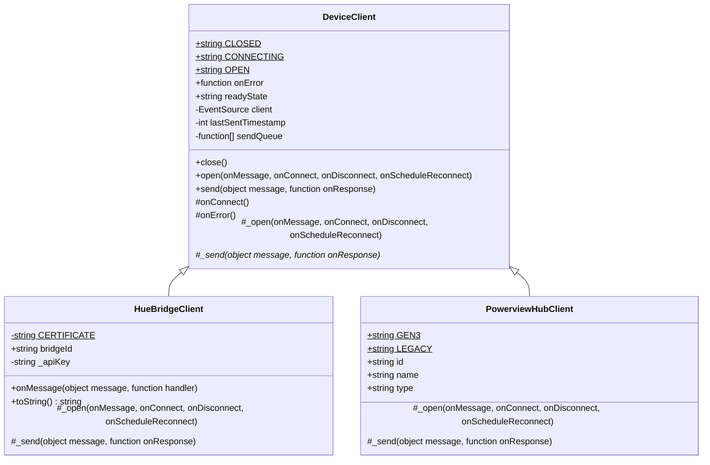
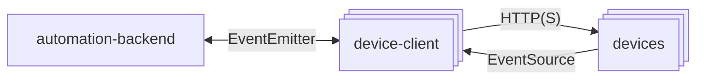
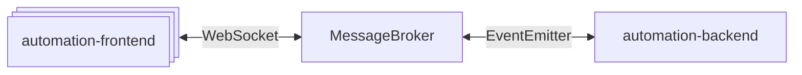
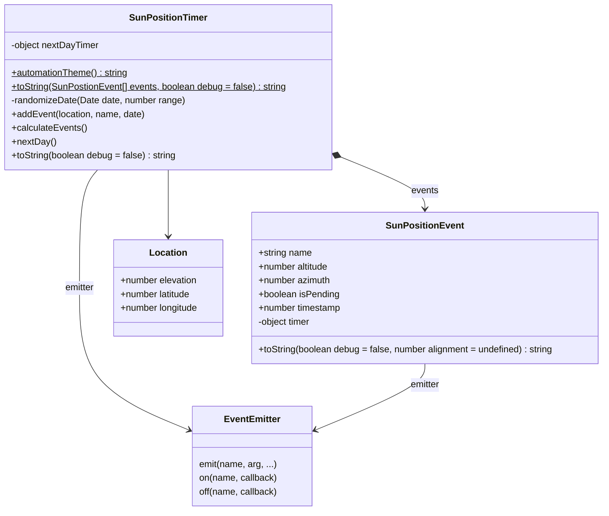
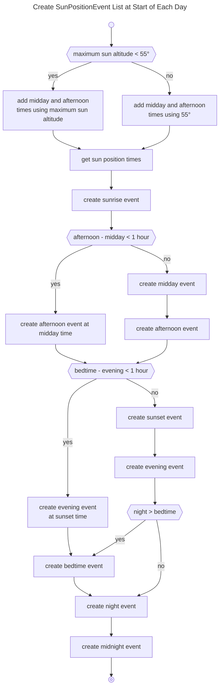
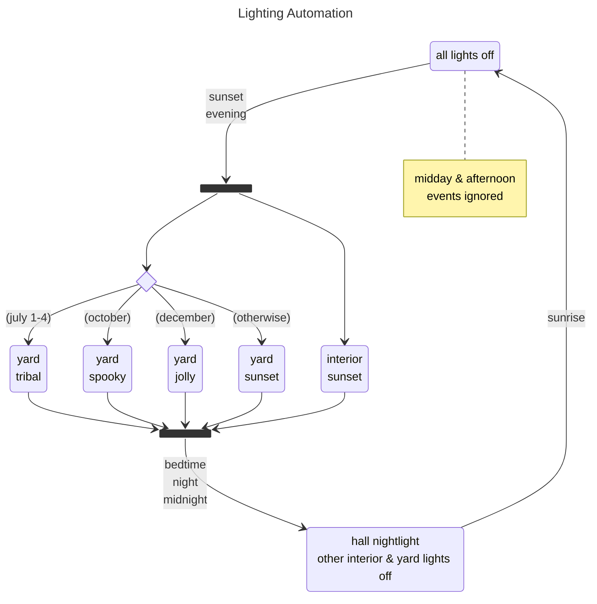
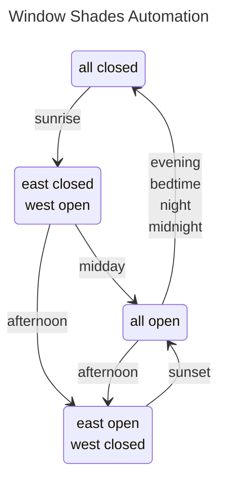

Copyright (c) 2026 Kirk Rader

# automation-backend

Monitor and control a [Hue] and [PowerView] based home automation system using
[express].

- [automation-backend]
  - [device-client](#device-client)
  - [message-broker](#message-broker)
  - [sun-position-timer](#sun-position-timer)

## Architecture



---



## Dependencies / Attributions

- [eventsource-client]
- [express]
- [suncalc]
- [undici]
- [ws]

...and, of course, all their transitive dependencies.

## Installation

```bash
npm i
```

## Configuration

Create `./automation-backend/config.js` with appropriate values for your
location and hardware:

```javascript
const config = {

    logger: {
        name: 'automation',
        maxBackups: 3,
        maxSize: 1047552,
    },

    frontendPort: 8080,
    wssPort: 8081,

    location: {
        latitude: 34.052238,
        longitude: -118.243340,
        elevation: 0,
    },

    hue: [
        {
            bridgeId: 'd53896fffec424ab',
            apiKey: '28a4QSK429JDHOyHidv5Ef1Tx-i-b4hYruFHVKIO',
        },
        {
            bridgeId: 'fab5faccbe212f0d',
            apiKey: '2P6zDhsdGdzmEXNMLmV21ypt404AVdxZY2ofksrH',
        },
    ],

    powerview: [
        {
            id: 'bff46430-9989-11f1-8be1-e31a95383439',
            address: '192.168.1.51',
            name: 'Living / Dining Room',
            type: 'legacy',
        },
        {
            id: '348cd80-9989-11f1-a63b-1f68433e5c42',
            address: '192.168.1.32',
            name: 'Kitchen',
            type: 'gen3',
        },
    ],
}

export default config
```

See <https://developers.meethue.com/develop/hue-api-v2/getting-started/> for an
explanation of the `hue.bridgeId` and `hue.apiKey` values (the latter being the
value to use as the value for the `hue-application-key` parameter when sending
HTTPS requests to the bridge API.)

## Launch

Browse to the URL displayed in the console window after invoking:

```bash
cd automation-backend
node index.js
```

## [automation-backend]

### [device-client]

An abstraction for integrating with HTTP and EventSource based API's presented
by various makes and models of home automation hardware. The abstraction layer
supports event-driven interaction and request rate limits when using HTTP.



---



### [message-broker]

Integrate (potentially) multiple WebSocket clients and the automation backend
using native _Node.js_ `EventEmitter` based events.



### [sun-position-timer]

Use [suncalc] to fire a number of time-of-day and day-of-year based events
intended to drive home automation scenarios.



#### Events



The `SunPositionTimer` class manages a collection of `SunPositionEvent`
instances over the course of each day. Each `SunPositionEvent` instance emits an
event at a particular time of day as determined by the sun's position in the sky
on a given date.

| Name        | Description                                                                    |
|-------------|--------------------------------------------------------------------------------|
| `events`    | A new set of `SunPositionEvent` instances has been created for the current day |
| `sunrise`   | Top limb of the sun rises above the horizon                                    |
| `midday`    | Sun reaches a maximum of 55&deg; altitude<sup>*</sup> while ascending          |
| `afternoon` | Sun reaches `midday` altitude  while descending                                |
| `sunset`    | Top limb of the sun sinks below the horizon<sup>**</sup>                       |
| `evening`   | One hour after `sunset`                                                        |
| `bedtime`   | Randomly chosen time between 9:00 PM and 10:00 PM                              |
| `night`     | Fully dark                                                                     |
| `midnight`  | 11:59 PM                                                                       |

<hr>

<i>

> <sup>*</sup>The times at which `midday` and `afternoon` events are triggered
> are when the sun reaches 55&deg; altitude, or the maximum sun altitude during
> the time of year that the sun never reaches 55&deg;. No `midday` event will be
> fired and `afternoon` will be sent instead when the sun first reaches its
> maximum altitude if there is less than an hour during which the sun is above
> the `midday` threshold.

<hr>

> <sup>**</sup>No `sunset` event will be fired and `evening` will be sent
> instead at sundown during the time of year that there is less than an hour
> between sunset and bedtime.

</i>

<hr>

As noted above for `midday`, some events may be skipped on a given day depending
on the latitude and longitude, when multiple events would otherwise be sent in
very quick succession. For example, `evening` will be sent instead of `sunset`
when the sun goes down if there is less than an hour between `sunset` and
`bedtime`, otherwise both `sunset` and `evening` will be emitted. Similarly,
`bedtime` will be skipped entirely if there is less than an hour between it and
`night`.

In extreme latitudes during periods in which the sun never rises or sets
`SunPositionTimer` will not emit any events and some other mechanism should be
used to trigger automations over the course of whatever time period makes sense
for the needs of a particular client.

Finally, note that a maximum of 55 degress altitude was chosen empirically for
`midday` and `afternoon` based on the needs of a particular home with a specific
set of east- and west-facing windows at a particular geographic location.

#### Lighting Theme

In addition to the `SunPositionTimer` and `SunPositionEvent` classes described
above, this module exports `automationTheme()` which returns a specific string
based on the date on which it is called:

| Theme      | Description                    |
|------------|--------------------------------|
| `tribal`   | July 1-4 (US Independence Day) |
| `spooky`   | Any day in October             |
| `jolly`    | Any day in December            |
| `standard` | Any other day                  |

#### Rationale

The repertoire of [events](#events) and [themes](#lighting-theme) listed above
are intended to support lighting and window covering automation for a particular
home at a specific location in the US with east- and west-facing windows. The
goal is to allow the window coverings to be open as much as possible during
daylight hours each day while avoiding having the sun shine too directly into
any rooms. Each combination of event and theme names corresponds to some set of
home automation "scenes" that are configured in the corresponding devices'
native apps.

---



---



[automation-backend]: ./index.js
[device-client]: ./device-client/index.js
[message-broker]: ./message-broker/index.js
[sun-position-timer]: ./sun-position-timer/index.js

[eventsource-client]: https://www.npmjs.com/package/eventsource-client
[express]: https://www.npmjs.com/package/express
[mermaid]: https://mermaid.ai/open-source/intro/
[suncalc]: https://www.npmjs.com/package/suncalc
[undici]: https://www.npmjs.com/package/undici
[ws]: https://www.npmjs.com/package/ws

[Hue]: https://developers.meethue.com/develop/hue-api-v2/getting-started/
[PowerView]: https://www.hunterdouglas.com/operating-systems/motorized/powerview